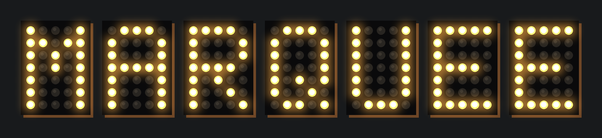
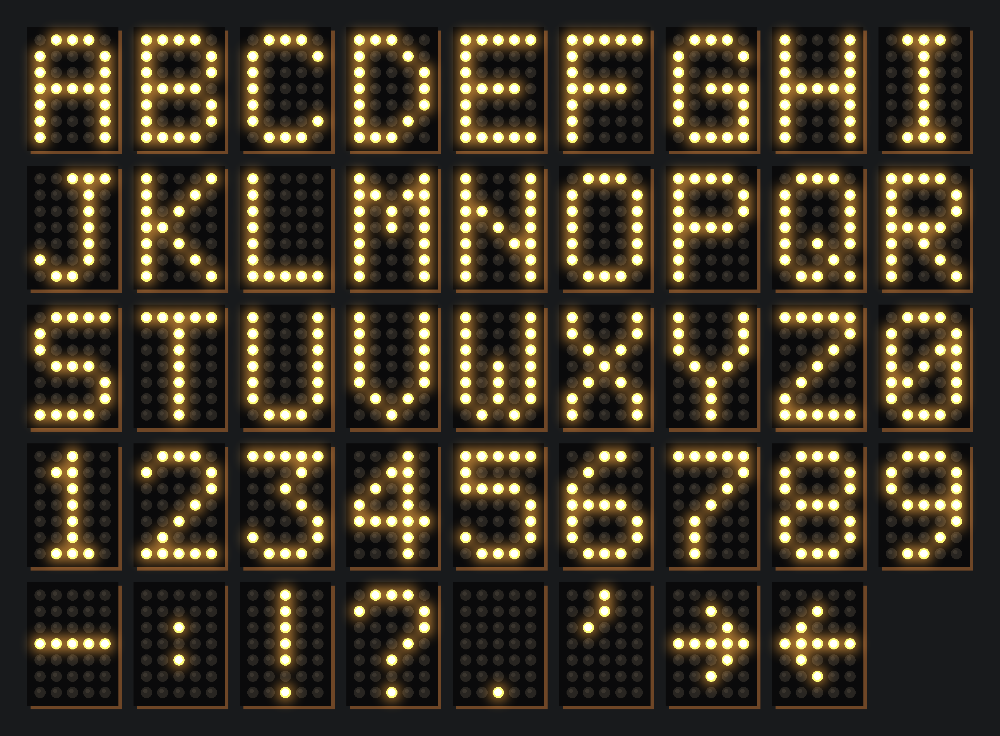

# MarqueeMatrix



A 5 × 7 grid of 120 V G40 marquee bulbs that spells one character at a time (A–Z, 0–9, `- : ! ? . '` and ← →), in a wood box with the electronics hidden in the back.

| | |
|---|---|
| Box | 336 × 456 × 110 mm, wood frame (12 mm walls) and 6 mm ply back |
| Bulbs | 35 × 120 V G40 E12 on a 60 mm pitch (38 on hand, 3 spare) |
| Face | 6 mm black cast acrylic, 35 × Ø24.6 mm socket holes (xTool P2) |
| Carrier | 6 mm cast acrylic, socket flanges screw to it (M3); screwed to 19 mm (3/4″) cleats on the side walls, which set the socket mouths flush with the face |
| Control | ESP32-C3 → 5 × 74HCT595 (daisy-chained, 3 GPIO) → 5 × 8-ch SSR boards (40 channels), on/off only |
| Power | Cord through a PG7 gland in the bottom wall → fused terminal block; 120 V → 5 V module for the logic |

**Open the live page:** https://claude.ai/artifact/27NbX2izJUi5tEKZeaorrt (source in `web/marquee_matrix.html`). It previews the sign (spell text with letters, digits, symbols and arrows, or count down 9 to 0), the font, the box section, the electronics and the parts list.

## Font



`font5x7.py` holds the 26 capital letters, the digits 0–9, `- : ! ? . '` and left and right arrows in the classic 5 × 7 dot-matrix style, so the sign can show times, scores and short messages such as 12:30, 3-1 or OPEN! one character at a time. In text, type `->` and `<-` for the arrows; `font5x7.glyphs()` does the conversion. The zero has a slash so it reads differently from O. Letters and digits light between 10 bulbs (1) and 20 (B); symbols light between 1 (.) and 9 (? and the arrows). Bulb number = row × 5 + column, counting from 0 at the top left; bulb *n* is on SSR board ⌊*n* ÷ 8⌋, channel *n* mod 8.

## Repository layout

```
font5x7.py              A–Z, 0–9, symbols and arrows (slashed zero); bulb index = row * 5 + col (0 = top-left). `python3 font5x7.py` previews them.
cad/
  marquee_matrix.py     parametric model (build123d); all dimensions at the top
  export.py             writes everything in fab/
  render_banner.py      draws docs/marquee.png and docs/font.png (`uv run --python 3.12 --with pillow cad/render_banner.py [WORD]`)
fab/                    versioned deliverables (generated; commit with the model change that made them)
  marquee_matrix.step   full assembly, every part labelled (Git LFS)
  cut/face.dxf|svg      6 mm black acrylic face (xTool P2)
  cut/carrier.dxf|svg   6 mm acrylic carrier (xTool P2)
docs/marquee.png        README images, drawn to scale from the font and box dimensions
docs/font.png
web/marquee_matrix.html the shareable page (artifact source)
out/                    scratch, git-ignored
```

## Rebuilding

The model is the source of truth. Rebuild `fab/` after any change and commit it together with the change:

```sh
uv run --python 3.12 --with build123d cad/export.py
```

The STEP file is stored with Git LFS. Run `git lfs install` once per machine before cloning or committing.

## Before building

- **Sockets:** dimensions are copied from MakeSign (24 mm body, 25 mm tall, 50 × 14 mm flange, holes 38 mm apart). Measure yours and update the socket block in `cad/marquee_matrix.py`.
- **SSR leakage:** zero-cross SSRs such as the G3MB-202P leak about 1 mA when off, which can make LED filament bulbs glow faintly. Test one bulb on one channel first. If it ghosts, add a bleeder (for example a 0.1 µF X2 capacitor in series with a 1 kΩ resistor across the socket) or use mechanical relay boards.
- **Electronics envelopes** in the model (SSR boards, controller, 5 V supply, terminal block) are approximate. Check them against the parts you buy.
- **Mains safety:** switch the hot (L) side through the SSRs and run a common neutral to every socket. Fuse the incoming line, strain-relieve the cord at the gland, keep the 120 V and 5 V wiring on separate sides of the bay, and cover the exposed mains terminals.
